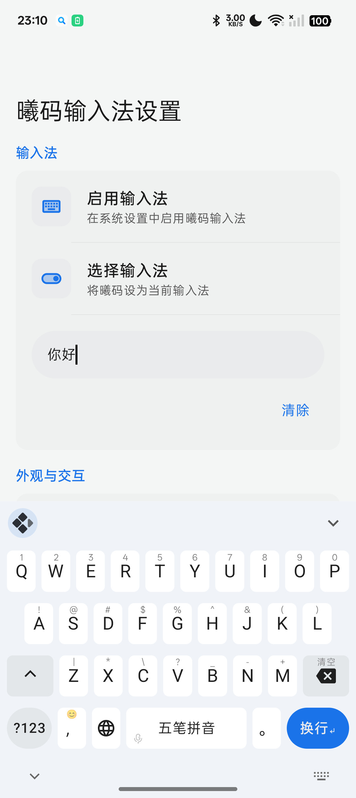
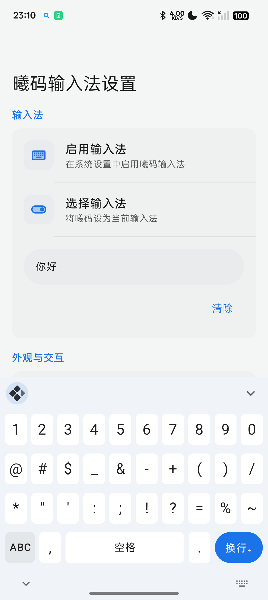
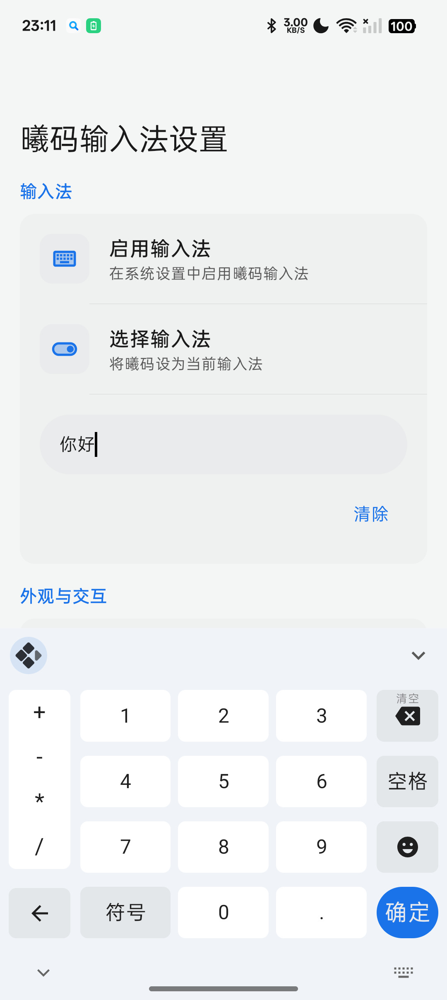
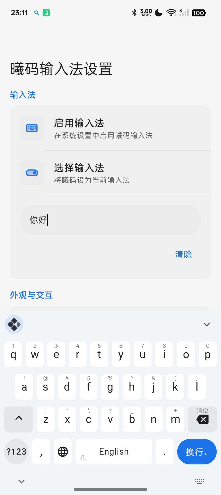

# Xime 键盘布局合集

给 [Xime](https://github.com/ximeiorg/Xime)（Android 输入法，Rime 内核）做的键盘布局预设。每个目录是一份完整的 `xime.custom.yaml`，放进 Xime 的用户配置目录就能用；目录名即布局风格。

> Keyboard layout presets for Xime. Each folder holds one `xime.custom.yaml` that overrides the built-in layout by style (WeChat / Sogou / Gboard / Fcitx5).


## 布局一览

| 目录 | 风格 | 覆盖范围 | 主色 |
|---|---|---|---|
| [`wetype/xime.custom.yaml`](wetype/xime.custom.yaml) | 微信输入法 | 26 键、九键、数字面板、通用符号；亮/暗双套配色 | 微信绿 `#07C160` |
| [`sougou/xime.custom.yaml`](sougou/xime.custom.yaml) | 搜狗输入法 | 26 键、九键、数字面板、通用符号；亮色按截图实测 | 搜狗橙 `#FB6D12` / 搜狗蓝 `#007AFD`（两套主题） |
| [`gboard/xime.custom.yaml`](gboard/xime.custom.yaml) | Gboard | 26 键、九键、？123 面板；几何按实机截图换算（圆角 6dp / 横缝 6.5dp / 竖缝 11.5dp、无阴影）；按键级外观把 `?123` 与换行做成圆键、换行用 `background: accent` 跟随主题强调色、字母键保留 Xime 的上滑/下滑；7 套 Gboard 主题（色值取自 APK 配色表） | 薄荷绿 `#4DB6AC` |
| [`fcitx5/xime.custom.yaml`](fcitx5/xime.custom.yaml) | Fcitx5 for Android | 26 键（alt = 1-0 / `@*+-=/ #()` / `':"?!~\`）、5 列数字小键盘；圆角 4dp / 横缝 6dp / 竖缝 14dp、无阴影；6 套主题（来自 0.1.3 的 ThemePreset.kt） | Pixel 蓝 `#4285F4` |
| [`comma_period/xime.custom.yaml`](comma_period/xime.custom.yaml) | 逗号 / 句号分列 | 26 键；控制行改为 `?123 ， 空格 。 地球 回车`，逗号在空格左、句号在空格右（中英各一套） | 内置主题 |
| [`number_rows/xime.custom.yaml`](number_rows/xime.custom.yaml) | 顶部数字行 | 26 键；5 行布局，最上面多一行 1-0，点按上屏、长按出符号 | 内置主题 |
| [`no_bubble/xime.custom.yaml`](no_bubble/xime.custom.yaml) | 无气泡 | 完整键位表；关掉按压缩放气泡与上/下滑内容气泡，长按气泡保留 | 内置主题 |
| [`flypy/xime.custom.yaml`](flypy/xime.custom.yaml) | 小鹤双拼助记 | 26 键 compact；下滑直接显示小鹤韵母（iu / ei / …） | 内置主题 |
| [`msdouble/xime.custom.yaml`](msdouble/xime.custom.yaml) | 第二行加「；」 | 26 键；第二行 10 键（多一个「；」），下滑显示五笔字根 | 薰衣草紫 `#8F73E2` |
| [`wubi_compact/xime.custom.yaml`](wubi_compact/xime.custom.yaml) | 五笔紧凑 | 26 键 compact；下滑显示五笔字根，键帽留白更紧 | 内置主题 |

每份配置都只写「和内置 `xime.yaml` 不一样的部分」，没写的字段自动回退内置值。

gboard 那份额外带了一份 Gboard 主题库，在 Xime 的主题设置里直接选。色值全部来自
Gboard 18.5.9 APK 内的 `assets/theme/style_sheet_color_*.binarypb`（protobuf 配色表），
不是目测，并用 adb 截真实键盘逐点核对过：

| 主题 id | 名称 | 亮色 底 / 键 / 功能键 | 暗色 底 / 键 / 功能键 | 强调色 |
|---|---|---|---|---|
| `gboard` | 浅色 / 深色 | `#F0F4F9` / `#FFFFFF` / `#E4E7E9`，深灰字 | `#263238` / `#3B464C` / `#2E3A40`，白字 | 薄荷绿 `#4DB6AC` |
| `gboard_google` | Google 浅色 / 深色 | `#F0F4F9` / `#FFFFFF` / `#E4E7E9`，深灰字 | `#363B40` / `#565A5E` / `#454B50`，白字 | 蓝 `#1A73E8` |
| `gboard_blue` | 蓝 | `#1565C0` / `#3F80CB` / `#2771C4`，白字 | 与亮色相同 | `#2196F3` |
| `gboard_red` | 红 | `#C62828` / `#D04E4E` / `#CA3838`，白字 | 与亮色相同 | `#F44336` |
| `gboard_green` | 绿 | `#43A047` / `#64B168` / `#51A755`，白字 | 与亮色相同 | `#2D7D32` |
| `gboard_teal` | 蓝绿 | `#00695C` / `#2E8479` / `#147468`，白字 | 与亮色相同 | `#4DB6AC` |
| `gboard_cyan` | 浅蓝绿 | `#80DEEA` / `#ACE9F1` / `#99E4EE`，深灰字 | 与亮色相同 | `#00ACC1` |

Gboard 把「浅色 / 深色」摆成两个格子，是因为它的主题是固定色、要用户手动选；Xime 的同一套
scheme 自带 `_dark` 字段、会跟随系统切换，所以这里把两对合并成一个主题。彩色 5 套是固定色，
亮暗同款，与 Gboard 自身行为一致。默认主题就是 `gboard`（跟随系统）。

### Gboard 布局实机截图

（真机 1080×2412，主题 `gboard_google`；截图里的浮动小圆钮是 Xime 自带工具条，不是本布局的元素）

<table>
  <tr>
    <td align="center"><br><sub>26 键（中文，五笔拼音）</sub></td>
    <td align="center"><br><sub>？123 符号面板</sub></td>
  </tr>
  <tr>
    <td align="center"><br><sub>数字面板</sub></td>
    <td align="center"><br><sub>26 键（英文）</sub></td>
  </tr>
</table>

fcitx5 那份同样带一套主题库。色值来自 fcitx5-android **0.1.3（versionCode 114）** 源码
`data/theme/ThemePreset.kt` 里的 `Theme.Builtin` 常量 —— 这些颜色写在 Kotlin 代码里、
不在 `res/values`，所以只能读源码（APK 里的 dex）而不能 aapt 导出：

| 主题 id | 名称 | 亮色 底 / 键 / 功能键 | 暗色 底 / 键 / 功能键 | 强调色 |
|---|---|---|---|---|
| `fcitx5_pixel` | Pixel 浅色 / 深色（默认） | `#FAFAFA` / `#FFFFFF` / `#E1E1E1`，字 `#212121` | `#2D2D2D` / `#464646` / `#373737`，字 `#FAFAFA` | `#4285F4` |
| `fcitx5_material` | Material 浅色 / 深色 | `#ECEFF1` / `#FBFBFC` / `#DFE2E4`，字 `#37474F` | `#263238` / `#404A50` / `#313C42`，字 `#D9DBDC` | `#5CB5AB` |
| `fcitx5_nord` | Nord 浅色 / 深色 | `#ECEFF4` / `#ECEFF4` / `#E5E9F0`，字 `#2E3440` | `#2E3440` / `#4C566A` / `#3B4252`，字 `#ECEFF4` | `#5E81AC` |
| `fcitx5_deep_blue` | 深蓝 | `#1565C0` / `#3F80CB` / `#2771C4`，白字 | 与亮色相同 | `#2196F3` |
| `fcitx5_amoled` | 纯黑 | `#000000` / `#2E2E2E` / `#141414`，白字 | 与亮色相同 | `#80CBC4` |
| `fcitx5_monokai` | Monokai | `#272822` / `#33342C` / `#2D2E27`，字 `#D6D6D6` | 与亮色相同 | `#B05279` |

fcitx5 的 11 套内置主题里，`TransparentLight/Dark` 没有收录：它们的键盘底色是真透明
（`0x00000000`），而 Xime 的颜色解析会把 ≤ `0xFFFFFF` 的值补成不透明，写进去会变成纯黑键盘。
`MaterialLight/Dark`、`PixelLight/Dark`、`NordLight/Dark` 三对按上面的方式合并成一个 scheme；
正式版 fcitx5 的默认主题是 Pixel（`ThemePrefs` 里只有 debug 构建才用 Material），所以默认给
`fcitx5_pixel`。

## 安装

请到app 扩展商店->布局安装下载

## 发布

[`release.yml`](.github/workflows/release.yml) 会把每个包含 YAML 的目录分别打成 `dist/<目录名>.zip`，再作为 Release 附件上传。两种触发，没有定时任务：

| 触发 | 行为 |
|---|---|
| 手动运行（Actions → Run workflow） | tag 留空 = 当天日期 `YYYY.MM.DD`（如 `2026.11.07`，不带 `v` 前缀），也可以填任意 tag；同一天重复运行会覆盖同名附件 |
| 网页上手动创建 Release | 沿用原行为：只把 zip 传上去，不改你写的标题和说明 |

几点细节：

- 日期固定用 `TZ=Asia/Shanghai` 生成，runner 是 UTC 也不会出现「差一天」的 tag。
- 同一个 tag 重复跑不会 422（`overwrite_files: true`），所以手动重试、当天补发都安全。
- Release 说明用 GitHub 自动生成的变更记录，比较基准是「上一个 release 的 tag」；手动创建的那个 release 不重新生成说明。
- 想每次 push 也自动发，在 `on:` 下加 `push: { branches: [main] }` —— 同一天多次 push 会更新同一个日期 tag。

## 许可证

[GPL-3.0](LICENSE)，与上游 Xime 一致。

```
Copyright (C) 2026 kingzcheung
```
